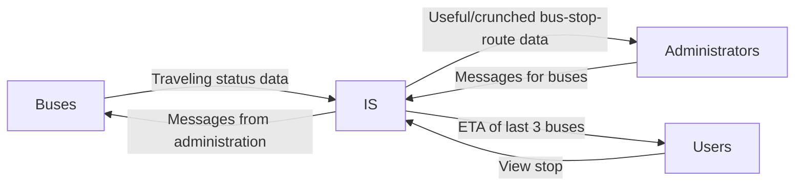

# Telemicro

A project that seeks to showcase Telematics skills through the development 
of a web application that handles telemetry from buses (micros), showcases an 
operations/administration panel, messaging between them, and finally give 
information to users (people) that want to know the ETA for buses for a particular stop.

This project will be slowly growing, but without the help of AI,
not because of hate, but to master the needed skills on my own.

Given the small scale by now, the documentation of the project will all be
centralized here.

## Documentation

### Context Diagram

The ETA of the last 3 buses shown for each stop to the Users has been decided like that, 
given that otherwise the users would be able to see the location of all the buses; this produces security 
concerns over the other buses, it's passengers and drivers. Thinking big (very early) also helps for controlled scalability.

### User Stories

#### US01:
As User, I want to see any stop and the Estimate Time of Arrival for the last three closest buses,
to exit on time to the stop depending on the comfort of schedule.

#### US02:
As Bus, I want to send and receive messages to and from the the Administration, to report emergencies and
known the directives from the Administration.

#### US03: As Administrator, I want to watch the information of each bus quickly,
to know it's position, status and route. 

#### US04: As Administrator, I want to communicate myself with the buses
through messaging, to become aware of emergencies and comunicate the bus appropiate
directives to follow and or relevant information.

#### US05: As Administrator, I want to watch each stablished route, it's stops,
and buses, as well as relevant statistics like average ETA for stop of a route, route's lenght,
amount of buses (per route and total), amount of stops (per route and total), and 
amount of Users (people) watching the stops of a path, to obtain
situational awareness of each element for ease of decision taking.

### Known limitations
For ease of development, this version or iteration will harcode the existing paths,
will use simulated data like Buses and Users, and will not care about authentication by now.

### Tech Stack used
  - PostgreSQL: For Data persistency and crunching, as well as management.
  - Node.js + Express.js: For Backend.
  - Eclipse Mosquitto: For low latency communication between Backend, Buses, Adminstrators and Users.
  - Frontend?
