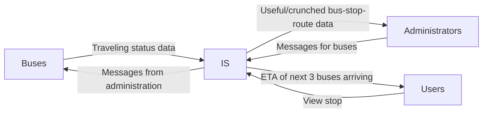

# Telemicro

A project that seeks to showcase Telematics skills through the development 
of a web application that handles telemetry from buses (micros), showcases an operations/administration panel, messaging between them, and finally give information to users (people) that want to know the ETA for buses for a particular stop.

This project will be slowly growing, but without the help of AI,
not because of hate, but to master the needed skills on my own. 

**Built by hand as a learning project**

Given the small scale by now, the documentation of the project will all be
centralized here.

### Current Status
  - [x] Write the project's outline
  - [x] Write the Context Diagram
  - [x] Write the first User Stories
  - [x] Add acceptance criteria
  - [x] Use standard form for User Stories
  - [ ] Split US05 into smaller USs.
  - [ ] Add non functional requirements
  - [ ] Create the Domain Model
  - [ ] Create the Architecture Diagram
  - [ ] Start modeling the communications between Backend, Database and MQTT Broker
  - [ ] Start modeling the MQTT Broker's topics
  - [ ] Start Database modeling (Logic-Relational diagram and Physical diagram)
  - [ ] Select a frontend...
  - Other development steps.

## Documentation

### Context Diagram

*Note: IS stands for the Telemicro Information System*

The ETA of the next 3 buses arriving shown for each stop to the Users has been decided like that, 
given that otherwise the users would be able to see the location of all the buses; this produces security 
concerns over the other buses, its passengers and drivers. Thinking big (very early) also helps for controlled scalability.

### User Stories

#### US01:
As a User, I want to see any stop and the Estimated Time of Arrival for the next three buses arriving,
so that I can leave on time for the stop.

**Acceptance Criteria**:
- Given that I opened the map within the website, when I select a stop in the map, then I want to see the next three buses arriving
- Given that I opened the map within the website, when I select a stop in the map, then I want to see the number of the buses that take the course 
of which the stop is part of.

#### US02:
As a Bus, I want to send and receive messages to and from the Administration, so that I can report emergencies and
know the directives from the Administration.
**Acceptance Criteria**:
- Given that I go to my view, when I type the Bus's license plate, then I want to see different options to quickly send messages: delayed, full bus, failure, diversion
- Given that I access to my view, when I type the Bus's license plate, then I want to see the messages sent from the Administration

#### US03: As an Administrator, I want to view the information of each bus quickly,
so that I get to know its position, status and route. 
**Acceptance Criteria**:
- Given that I access my panel, when I type in my id and password, then I want to select any bus in the city's map
- Given that I accessed my panel, when I select any bus in the city's map, then I want to see all it's information 
(driver, path, % of path completed), as well as latest messages

#### US04: As an Administrator, I want to communicate with the buses
through messaging, so that I become aware of emergencies and communicate the bus appropriate
directives to follow and or relevant information.
**Acceptance Criteria**:
- Given that I accessed my panel, when I select any bus in the city's map, then I want to be able to send him messages
- Given that I am chatting with a Bus, when I send a message, then I want to se if it arrived or not to the bus

#### US05: As an Administrator, I want to view each established route with its stops and buses,
so that I know what is currently operating in the city.
**Acceptance Criteria**:
- Given that I accessed my panel, when I open the routes view, then I want to see the list of established routes.
- Given that I selected a route, when its details load, then I want to see its stops and the buses currently assigned to it.

#### US06: As an Administrator, I want to see operational statistics per route and for the whole network,
so that I can assess the state of the service at a glance.
**Acceptance Criteria**:
- Given that I selected a route, when its statistics load, then I want to see the route's length, number of stops, number of buses and the average ETA per stop.
- Given that I am on the overview, when it loads, then I want to see the total number of buses and the total number of stops.

#### US07: As an Administrator, I want to see how many Users are watching each stop of a route,
so that I can identify where demand is higher and decide where to reinforce service.
**Acceptance Criteria**:
- Given that I selected a route, when the demand view loads, then I want to see the number of Users currently watching each of its stops.
- Given that Users stop watching a stop, when some time has passed, then I want that count to decrease.

### Known limitations
For ease of development, this version or iteration will hardcode the existing routes,
will use simulated data like Buses and Users, and will not care about authentication by now.

### Tech Stack used
  - PostgreSQL: For Data persistency and crunching, as well as management.
  - Django: For Backend.
  - Eclipse Mosquitto: For low latency communication between Backend, Buses and Administrators.
  - Frontend?
  - Hardware: Raspberry Pi 3 for Bus simulation (through Python), ESP32 + GPS for real data gathering (in the future)
  - Containerization: Docker. For Ease of development and deployment.

